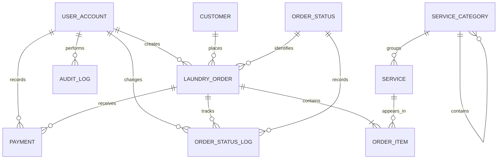

# Wash 'n Dry: Design, Security, and Operations Evidence

This document records the design evidence for the database and application. It is
intended to be submitted with the source code and completed with screenshots from
the local XAMPP installation.

## ERD



The complete column-level data dictionary is represented by the `CREATE TABLE`
definitions in [database/schema.sql](./database/schema.sql). Every table has a
primary key; relationship columns have foreign keys and business fields have
appropriate `NOT NULL`, `UNIQUE`, `CHECK`, or `DEFAULT` constraints.

## Normalization walkthrough

The original unnormalized order record can be represented as:

`Order(order_no, customer_name, customer_contact, service_1, quantity_1,
service_2, quantity_2, payment_1, payment_2, status)`

1. **1NF:** Repeating service and payment groups are removed into rows. Each
   service line becomes an `order_item` row and each payment becomes a `payment`
   row. All attributes are atomic.
2. **2NF:** `order_item` uses the composite key `(order_id, service_id)`.
   Quantity and captured unit price depend on the whole key. Customer, service,
   user, and status attributes are moved to their own tables because they do not
   depend on the complete order-line key.
3. **3NF:** Transitive dependencies are removed: customer details are stored in
   `customer`, service category details in `service_category`, status names and
   ordering in `order_status`, and account details in `user_account`.
4. **BCNF observation:** The determinants `customer_id`, `service_id`,
   `order_id`, `user_id`, and `status_id` are candidate keys of their respective
   relations. The captured `order_item.unit_price` is intentionally retained as
   a historical snapshot, not as a second current price.

Important functional dependencies include:

* `customer_id -> first_name, last_name, contact_no, address`
* `service_id -> category_id, service_name, soap_brand, unit_type, unit_price`
* `(order_id, service_id) -> quantity, unit_price`
* `order_id -> customer_id, user_id, status_id, order_date, total_amount`
* `payment_id -> order_id, user_id, amount_paid, payment_method, payment_date`
* `status_id -> status_name, sequence_no`

## SQL features

The schema includes two reporting views, three business routines, a scalar
balance function, and audit triggers. The application also demonstrates
parameterized queries, joins, subqueries, `GROUP BY`, and a CTE in the report
screen. The `sp_refresh_payment_status` routine recalculates payment state from
all payments rather than blindly trusting a client-provided value.

## Authentication and authorization

Passwords use salted PBKDF2-HMAC-SHA256 hashes with 600,000 iterations. The
three roles are:

* **Admin:** full management and user-account access.
* **Staff:** customer, order, payment, and status operations.
* **Viewer:** read-only operational access plus reports.

Authorization is checked by application methods, not merely by hiding buttons.
All SQL values are passed as connector parameters. A demonstration test should
attempt the username value `' OR '1'='1` and confirm that it is treated as
literal text and does not authenticate.

`customer.contact_no` is now stored as a Fernet authenticated-encryption token;
the key is loaded from `WASHNDRY_CONTACT_KEY` or the ignored local `.contact.key`
file. `customer.contact_hash` stores a SHA-256 token for duplicate detection
without searching the encrypted value. The key must be backed up separately
from the SQL dump and must never be committed.

## Transactions and concurrency

Order creation/editing, payment recording, cancellation, and status changes use
explicit transactions. Rows are locked with `SELECT ... FOR UPDATE` before
calculating balances or changing status. If two staff members attempt to record
the same remaining balance, the second transaction waits, re-reads the locked
row, and receives a clear overpayment error instead of creating a lost update.

* **Atomicity:** related order, item, payment, and log changes commit together.
* **Consistency:** foreign keys, checks, and application business rules reject
  invalid states.
* **Isolation:** InnoDB row locks prevent concurrent balance/status races.
* **Durability:** committed InnoDB transactions survive normal server restarts.

## Backup and recovery procedure

With XAMPP MySQL running, either use phpMyAdmin **Export > SQL > Go**, or run:

```powershell
& "C:\xampp\mysql\bin\mysqldump.exe" -u root -p --routines --triggers washndry > washndry_backup_YYYY-MM-DD.sql
```

To test recovery, create a temporary customer, export the database, delete that
customer, and restore through phpMyAdmin **Import** or:

```powershell
& "C:\xampp\mysql\bin\mysql.exe" -u root -p washndry < washndry_backup_YYYY-MM-DD.sql
```

Record screenshots showing the exported file, the simulated deletion, the
successful import, and the recovered record.

## Performance evidence

The schema indexes order dates, payment dates, audit timestamps, audit users,
and all primary/unique keys. Capture a baseline and indexed plan with:

```sql
EXPLAIN SELECT * FROM laundry_order
WHERE order_date >= '2026-01-01' AND order_date < '2026-02-01';
```

Compare the plan before and after `idx_order_date`, noting access type, selected
key, estimated rows, and measured execution time.

## Reporting and future scale

`v_sales_by_service` and the Sales Summary screen provide OLAP-style totals by
service. At larger scale, a warehouse could add a `fact_order_line` table with
date, service, customer, and status dimensions. A scheduled ETL process could
populate monthly aggregates for a dashboard without slowing transactional
checkout operations.

## Data governance and ethics reflection

The system stores names, mobile numbers, addresses, order histories, payment
amounts, and staff activity. Access should follow least privilege, accounts
should be deactivated promptly, and backups should be encrypted and retained
only as long as operationally necessary. A real deployment in the Philippines
must consider the Data Privacy Act of 2012, transparency and consent, purpose
limitation, data-subject access/deletion requests, breach notification, and
contracts with hosting or backup providers. Risks include exposing customer
locations, linking repeated visits to a person, insider misuse, and keeping
backups longer than necessary. The operator should publish a privacy notice,
define retention periods, review audit logs, train staff, and test restoration
without exposing production data.

## UI/UX evidence

The implemented GUI uses a consistent sidebar, typography, color palette,
tables, specific validation messages, back/cancel navigation, and confirmation
dialogs for destructive actions. Attach the pre-coding wireframe and a short
design note explaining the sidebar navigation, status colors, and confirmation
step when submitting the final project.

## Evidence files

Use [SECURITY_TESTS.md](./SECURITY_TESTS.md) for the injection and role tests,
[PERFORMANCE_TESTS.md](./PERFORMANCE_TESTS.md) for `EXPLAIN` results, and
[REFLECTION.md](./REFLECTION.md) as the individual reflection draft. The
wireframe artifact is [WIREFRAME.md](./WIREFRAME.md).
